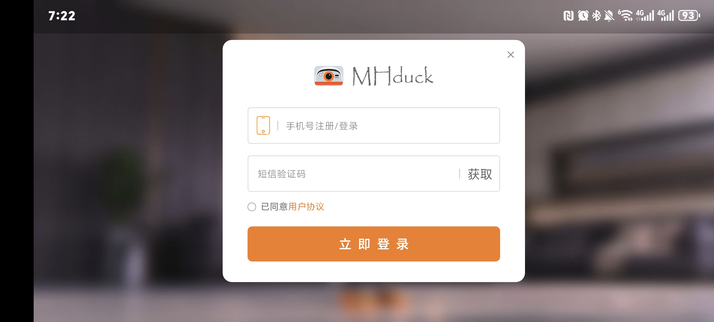
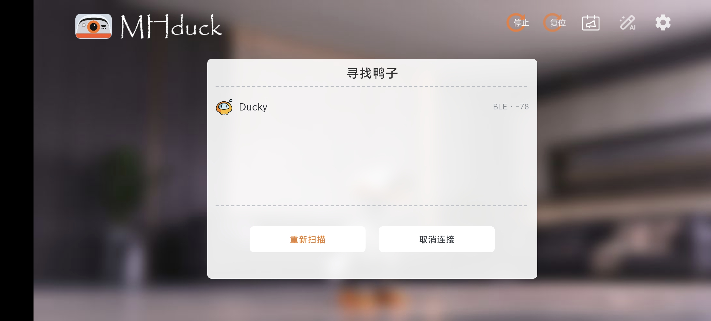
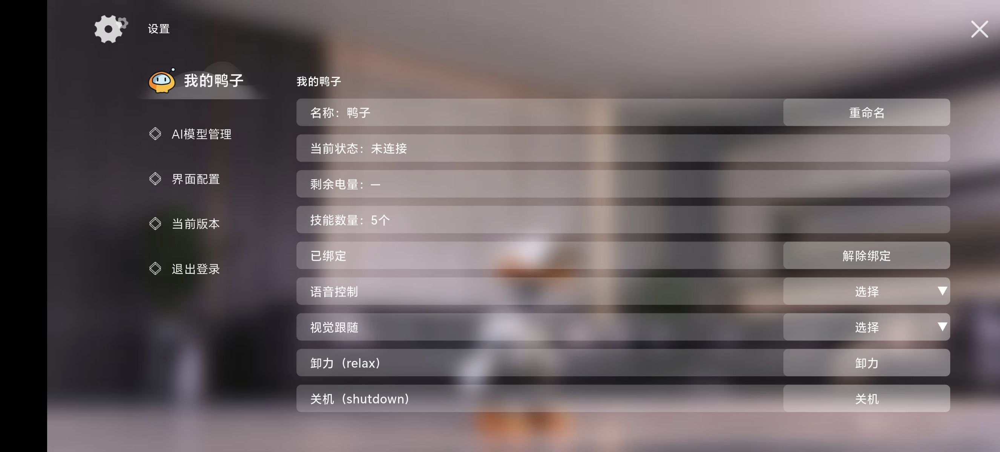
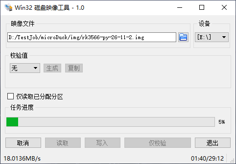

# Microduck 入门指南

> [!IMPORTANT]
> **本指南以 GitHub 上的最新版本为准。**
>
> **[点击查看 GitHub 最新版《Microduck 入门指南》](https://github.com/MHDuck/microduck/blob/master/Microduck%E5%85%A5%E9%97%A8%E6%8C%87%E5%8D%97.md)**
>
> 使用前请查看在线最新版；下载、打印或转发的副本可能已过时，如内容有差异，请以 GitHub 最新版为准。

适用对象：已收到完成系统安装、机器人程序部署和出厂配置的 Microduck 的客户。

本文先介绍 **APP 操作**：手机号注册 / 登录 → 扫描附近鸭子的蓝牙 → 连接并绑定 → 操控与手动解绑。

需要使用电脑时，再按后文进行 **SSH 命令行操作**：连接热点 → SSH 登录 → 更新软件、模型和程序 → 可选修改 Wi-Fi → 键盘 / 语音控制 → 退出和关机。

如果遇到 **TF 卡文件损坏**，请按[第 9 节：恢复出厂设置](#9-恢复出厂设置tf-卡文件损坏时)下载出厂镜像，使用 Win32 Disk Imager 重新写入 TF 卡。

项目仓库：

- **运行与部署仓库**：[MHDuck/microduck](https://github.com/MHDuck/microduck)，包含机器人运行程序、硬件驱动、部署脚本和使用文档。
- **模型训练仓库**：[MHDuck/microduck_rl](https://github.com/MHDuck/microduck_rl)，用于运动策略训练与 ONNX 模型导出。

> **关于示例回复：**本文中的终端输出均为示例，不是客户设备的实测记录。键盘提示依据编写时的项目脚本整理；设备上的程序版本、系统语言、IP 地址和提示文字可能不同。热点与登录密码采用交付信息，不是 Armbian 通用默认值。请勿把示例输出当作需要输入的命令。

## 0. 使用前准备

准备好手机、Microduck 和配套电池；使用 SSH 命令行操作时，还需准备电脑。先在平整、防滑、远离桌沿和台阶的地面上操作。上电、启用模型、重启控制服务和退出控制前，都要扶稳或托住机身，手指避开运动关节。

### 0.1 用 APP 操作（目前仅提供安卓 APK）

先在安卓手机上安装 MHduck APP。目前仅提供安卓 APK 安装包。

#### 第 1 步：使用手机号注册 / 登录

打开 APP，输入手机号码，点击“获取”接收短信验证码。填写验证码，阅读并同意用户协议后，点击“立即登录”，完成注册 / 登录。



*图 1：使用手机号和短信验证码注册 / 登录。*

#### 第 2 步：扫描附近鸭子的蓝牙

给 Microduck 上电并等待启动完成，开启手机蓝牙，将手机靠近鸭子。按手机提示允许 APP 使用蓝牙及搜索附近设备所需的权限，在“寻找鸭子”界面扫描附近的鸭子。

如果显示“没有发现 duck 设备”，确认鸭子已开机并靠近手机，再点击“重新扫描”（图 2）。发现设备后，点击对应的鸭子连接；图 3 中的设备名称为 `Ducky`，实际名称以你的设备为准。


*图 2：未发现设备时，点击“重新扫描”。*



*图 3：选择扫描到的鸭子，连接蓝牙。*

#### 第 3 步：确认绑定，交给他人前手动解绑

**连接蓝牙后，APP 会将该鸭子绑定到你的手机；必须手动解除绑定后，其他人才能使用。断开蓝牙不等于解除绑定。**

需要交给其他人使用时，点击主界面右上角的齿轮图标，进入“设置” → “我的鸭子”，点击“解除绑定”，按提示完成解绑（图 4）。解绑完成后，其他人再用自己的手机扫描并连接。



*图 4：即使当前状态为“未连接”，仍可能显示“已绑定”；请手动点击“解除绑定”。*

#### 第 4 步：操控鸭子

连接后，在 APP 操控界面使用**左手控制方向，右手控制动作**。

*操控界面配图待补充。*

### 0.2 使用 SSH 命令行前

以下第 1～8 节介绍电脑端 SSH、更新和键盘 / 语音控制。使用这些功能前，需要具备 Windows 和 Linux 命令行的基础操作能力，包括打开终端、输入命令、查看输出和使用 SSH 登录。

本文的命令分为两类：

- **电脑端命令**：SSH 登录命令可在 Windows CMD、PowerShell 或 Linux 终端执行；第 3.4、3.5 节的更新脚本必须在电脑的 **Ubuntu / WSL Ubuntu** 中执行。
- **机器人端命令**：SSH 登录成功后执行，例如 `sudo systemctl restart robotd`。不要直接在尚未登录的 Windows 终端输入这些命令。

带 `PS C:\Users\Customer>` 或 `radxa@radxa:~$` 的代码块展示完整终端交互。这些是提示符，不需要输入；只输入提示符后面的命令。

## 1. 用手机建立默认 Wi-Fi 热点

打开手机的“个人热点”或“便携式热点”，设置：

| 项目 | 内容 |
| --- | --- |
| 热点名称（SSID） | `MOHENG`，全部大写 |
| 热点密码 | `88607979` |

热点名称和密码必须完全一致，不要多输空格。保持热点开启；如果手机有“无人连接时自动关闭热点”设置，首次连接时关闭该选项。

按本次交付配置，Microduck 开机后会尝试自动连接 `MOHENG`。若始终连接不上，可将手机热点切换到 2.4 GHz 或兼容模式后再试。

## 2. 给 Microduck 上电，电脑连接同一个热点

1. 扶稳 Microduck，按交付时说明接好配套电池并上电。
2. 将电脑的 Wi-Fi 也连接到 `MOHENG`，密码同样是 `88607979`。
3. 等待约 1 分钟，让机器人完成系统启动和 Wi-Fi 连接。若尚未出现，可以再等 1～2 分钟。
4. 在手机热点的已连接设备列表中确认电脑和机器人已连接；设备名称可能显示为 `radxa`，也可能只显示 IP 或其他名称。

电脑和机器人必须处在同一局域网内。仅进行 SSH 和键盘控制不要求能够访问互联网，但热点必须允许连接设备之间互相通信。

## 3. 通过 SSH 登录 Microduck

### 3.1 使用 CMD、PowerShell 或 Linux 终端

在**电脑端**输入：

```bash
ssh radxa@radxa.local
```

首次连接时可能显示主机身份确认。以下是**示例交互**，方括号中的内容是说明或占位符：

```text
PS C:\Users\Customer> ssh radxa@radxa.local
The authenticity of host 'radxa.local ([设备实际IP])' can't be established.
ED25519 key fingerprint is SHA256:[设备实际指纹].
Are you sure you want to continue connecting (yes/no/[fingerprint])? yes
Warning: Permanently added 'radxa.local' (ED25519) to the list of known hosts.
radxa@radxa.local's password:
[系统欢迎信息省略]
radxa@radxa:~$
```

确认连接的是本次交付的机器人后，输入 `yes` 并回车。在密码提示处：

**按 3 次空格键，再按回车。密码是连续三个半角空格，不是数字 `3`，也不是文字“三个空格”。**

输入密码时终端通常不会显示字符或星号，这是正常现象。出现类似 `radxa@radxa:~$` 的提示符，表示已经进入机器人。

后面的 `sudo` 命令如果提示 `[sudo] password for radxa:`，在尚未修改账户密码的情况下，也输入这三个空格；如果没有询问密码，直接继续即可。

### 3.2 使用 PuTTY

PuTTY 是独立 SSH 客户端：

1. 打开 PuTTY，在 **Host Name** 中填写 `radxa.local`。
2. **Port** 填 `22`，**Connection type** 选择 `SSH`，点击 **Open**。
3. 首次出现主机密钥提示时，确认是本次交付设备后接受。
4. `login as:` 后输入 `radxa`。
5. 密码输入连续三个空格，再回车。

### 3.3 如果 `radxa.local` 无法连接

如果 **SSH 连接不上鸭子**，可以先按第 0.1 节使用安卓 APK，在 APP 中扫描并尝试连接鸭子的蓝牙，初步确认设备是否已启动。蓝牙连接成功后，再继续排查 Wi-Fi、IP 地址和 SSH 服务。

若出现 `Could not resolve hostname radxa.local`，到手机热点的已连接设备信息中查看机器人的实际 IP，改为按 IP 登录。例如，**仅当实际 IP 确实是 `192.168.43.120` 时**：

```bash
ssh radxa@192.168.43.120
```

PuTTY 也可以把 Host Name 改成该实际 IP。本文所有 IP 均为示例，不要直接认定设备使用这个地址。

如果使用实际 IP 仍然超时，确认电脑和机器人都连着 `MOHENG`，并检查热点是否限制设备互访。需要时换一部手机建立同名、同密码热点；不要让两个同名热点同时开启。

### 3.4 更新最新软件（完整部署）

在**电脑的 Ubuntu / WSL Ubuntu 终端**中进入运行与部署仓库的根目录（能看到 `scripts/` 和 `xh_push.sh` 的目录）。不要在机器人 SSH 终端执行下面的更新脚本。电脑与机器人均需联网，以下以 `172.20.10.5` 为例，请换成设备实际 IP，用户名为 `radxa`。

先取得本仓库的最新源码和 `policies/` 模型文件。下面两种更新方式都使用**电脑上当前仓库的内容**，不会自动拉取 Git 最新版本或训练新模型。更新前托稳机器人，退出旧键盘控制程序；板端调好的参数应先同步回本地 `deploy/robotd.toml`，上传会覆盖板端正式配置。

首次部署、补齐语音环境或需要完整更新软件时执行：

```bash
bash scripts/provision-board.sh \
  --pause-btd-on-pair \
  --name Ducky \
  radxa@172.20.10.5
```

脚本自动准备电脑端构建工具和 SSH 密钥，编译程序，初始化或刷新板端环境，等待板子重启，更新 `robotd`、`mediad`、`padd`、模型和配置，并安装、检查语音环境。已有安装会先备份。按提示输入本机 sudo 密码或机器人账户密码，保持终端、网络和供电可用，直到出现 `provisioning finished`。

`--pause-btd-on-pair` 设置手柄配对兼容行为，`--name Ducky` 设置机器人名称。完整部署已包含下一节的程序和模型更新，无需连续再执行一次。部署完成后语音默认关闭，按第 5.8 节开启。更多细节见[重新部署软件](重新部署软件.md)。

### 3.5 更新最新模型和程序（增量更新）

板端环境已部署好、只需要更新本地仓库中的模型和程序时，在**电脑的 Ubuntu / WSL Ubuntu 终端、仓库根目录**执行：

```bash
bash xh_push.sh --build radxa@172.20.10.5
```

此命令先编译，再上传 `robotd`、`mediad`、`padd`、`policies/*.onnx`、配置及控制脚本，并校验文件。更新时重启 `robotd`，恢复原本运行中的 `mediad` / `padd`；原本停止的客户端保持停止。完成后退出旧键盘进程，重新按第 5 节启动控制。

`--build` 使用 Cargo 离线缓存；如果提示缺少依赖，在电脑仓库根目录先运行 `cargo fetch --locked`，再重跑更新命令。此命令不安装语音依赖或语音模型，需要补齐语音环境时使用第 3.4 节。

## 4. 修改机器人保存的 Wi-Fi 名称或密码（可选）

继续使用 `MOHENG` 可跳过本节。需要修改时，先退出控制并放稳机器人，在**机器人端 SSH 终端**执行：

```bash
sudo nano /etc/NetworkManager/system-connections/robot-wifi.nmconnection
```

修改 `[wifi]` 下的 `ssid=`（Wi-Fi 名称）和 `[wifi-security]` 下的 `psk=`（Wi-Fi 密码），其余配置保留。

按 **Ctrl+O → Enter** 保存，再按 **Ctrl+X** 退出。保存后，机器人下次启动时使用新配置。

**请记住新的 Wi-Fi 名称和密码，并让电脑连接同一网络后再 SSH 登录。**

## 5. 启动 Microduck 键盘控制

### 5.1 准备键盘控制

扶稳机器人，在**机器人端 SSH 终端**执行：

```bash
sudo systemctl stop padd
```

此命令停止手柄控制，避免手柄和键盘同时发送指令。正常情况下没有输出，直接返回命令提示符。

不必先手动启动 robotd：下面运行键盘程序后，按 Enter 会重启服务并检查模型、IMU 是否就绪。

### 5.2 启动键盘控制程序

```bash
sudo python3 /opt/robot/daemon/current/scripts/keyboard-control.py
```

程序会先显示按键说明，然后在同一行刷新简短状态，例如 `未启用，按 Enter 起身`。如果服务尚未启动，也可以看到 `robotd 未连接`，仍可按 Enter 恢复。**此时不是 Linux 命令行，不要在这里继续粘贴其他命令。**

### 5.3 按 Enter 重启服务并自主起身

在平整地面上准备好起身空间，手指避开关节并在旁保护，轻点一次 **Enter（回车）**。每次有效按下都会重启 robotd，等待模型和 IMU 就绪，再调用 StandUp 模型从地上自主起身。

正常过程的示例提示：

```text
正在重启 robotd……
起身中……
起身完成，可继续行走。
站立中
```

当前配置使用 `standup_hd1910_v6.onnx`，直接执行 StandUp，不先走 HOME 或 T 键的坐站切换。起身动作最长 12 秒；机器人直立且转动缓慢的有效 IMU 样本累计达到 500 ms 后，程序才判定完成。超时未完成会请求卸力，主界面给出简短故障，按 C 查看详情。

行走中摔倒、倾倒保护或过流保护后，可以排除故障、准备好起身空间，再按 Enter 重启并起身。**Enter 每次都会重新启动这套流程，已经站稳时不要把它当作普通确认键反复按。**起身期间暂缓倾倒锁定和预测降力，过流保护仍按配置执行。

主界面只显示一条状态或故障，例如 `站立中`、`行走中`、`倾倒中`、`倒地中`、`倾倒保护了`。不会常驻显示速度、IMU 数值、键盘开关或语音开关；详细数据统一按 C 查看。

**速度为零不代表电机卸力，也不保证机器人完全不踏步。**刚开始请始终在旁保护。

### 5.4 使用 W / S 调整前后速度

| 按键 | 作用 |
| --- | --- |
| `W` | 每按一次，前后指令速度 `vx` 增加 `0.10 m/s` |
| `S` | 每按一次，前后指令速度 `vx` 减少 `0.10 m/s` |
| 空格 | 所有指令速度归零，仍保持模型启用 |

从零开始轻点 W，每次增加的指令速度依次为 `+0.10`、`+0.20`、`+0.30 m/s`。主界面只显示 `行走中`；需要核对速度时，按 C 查看日志中的 `v=(vx,vy,vyaw)`，例如：

```text
v=(+0.10,+0.00,+0.00)
v=(+0.20,+0.00,+0.00)
v=(+0.30,+0.00,+0.00)
```

这些是**指令速度**，不是实测行走速度。先从 `+0.10 m/s` 试走，稳定后再逐步调整。

**客户入门操作要求：不要超过 `0.30 m/s`；前进和倒退均按速度绝对值不超过 `0.30 m/s` 控制。地面或姿态不稳定时，应进一步降低速度。**

当前脚本实际允许 `-0.40～+0.40 m/s`，因此 `0.30` 不是程序自动锁住的上限。长按会连续调速，可能很快超过入门限制，请使用短按，并在 C 日志里核对数值。再次按 C 可返回简洁界面。

还要注意：

- **松开 W / S 后，前后速度会保持，不会自动停止。**要停下请按空格。
- S 的含义是“减小有符号速度”。从 `+0.10` 按一次 S 到零，再按一次会到 `-0.10`，变成倒退。
- 想立即让指令速度归零时，优先按空格，不要反复按 S 猜测是否已经停下。

速度归零后，walk 会继续运行约 3 秒，再自动切到 StandUp 保持站姿；重新给出移动指令会重新计时。这里的切换依据平滑后的指令速度，不是实测移动速度。主界面仍显示简短状态，实际 ONNX 文件名在 L 运行日志中查看。

### 5.5 坐下和站起

1. 先按空格让所有指令速度归零；需要核对时，在 C 日志里查看 `v=(+0.00,+0.00,+0.00)`。
2. 等机器人姿态稳定，扶好机身，轻点 **T**，请求坐下。
3. 等坐下动作完成并稳定后，再轻点 **T**，请求站起。
4. 两次点按至少间隔 1 秒，并且必须等前一次动作完成；不要长按 T。

T 需要在 Enter 启用后使用。程序也会在发送坐站请求前把速度归零，但操作时仍应先停稳。

T 使用坐站切换模型，主界面可显示 `坐姿中` 或 `起身中`，不再打印 5 秒关节位置或坐站请求日志。请结合实际姿态确认动作完成；T 不负责重启服务或从摔倒中恢复，摔倒后的自主起身使用 Enter。若提示坐站切换失败，先保持支撑，按 C 查看原因。

T 站起时，sitstand 的 rising 阶段运行 3 秒，然后在零速下自动交给 StandUp 稳定站姿，不再继续停留在 rising 模型。坐下后仍由 sitstand 保持坐姿。

### 5.6 其他按键

| 按键 | 作用 |
| --- | --- |
| `A` / `D` | 增减横移速度 `vy`，每次 0.10 m/s，范围 -0.40～+0.40 m/s，松开保持 |
| `Q` / `E` | 左右转向 |
| `C` | 打开 / 关闭详细日志；连接正常时同时开始 / 停止电流 CSV 记录 |
| `L`（行走模式） | 独立打开 / 关闭运行日志，查看 ONNX 文件、模型切换、起身和保护；不开始电流 CSV |
| `H` | 开启 / 关闭行走发声（播放鸭叫），不控制语音识别 |
| `Esc` / `Ctrl+C` | 退出控制，执行卸力；默认连接下同时停止 robotd 服务 |

横移速度 `vy` 与前后速度 `vx` 一样，松开保持，长按连续调速，按空格归零。转向松开后约 0.3 秒归零，**不会清除已经设置的 `vx` 和 `vy`**。初次体验建议先只使用 Enter、W、S、空格、T 和 Esc。

### 5.7 简短故障和 C 详细日志

正常控制时只看一条状态。发生故障时，状态栏优先显示简短原因，例如 `22 电机无响应`、`BNO085 连接异常`、`ONNX 文件缺失`、`配置文件错误` 或 `电机过流保护了`。只有错误信息包含电机编号时才会显示具体编号；详情不足时显示 `电机通信异常`。

按 C 可查看速度、IMU、重力 z、倾倒配置与累计时间、实际策略、电流以及原始错误，同时回放最近 100 条诊断消息。即使 robotd 未连接，也能按 C 查看错误。连接正常时，电流 CSV 保存到启动命令所在目录的 `logs/`，也可通过 `--log-dir` 指定目录；原始错误日志显示在终端，不写入电流 CSV。

再次按 C 关闭详细日志并结束电流记录；L 也关闭时返回简洁界面。C 只切换显示和记录，不会自动停车，停车仍按空格。两次点按 C 请间隔 1 秒以上。Enter 重启服务会结束当前电流记录；恢复后如详细日志仍开启，先按 C 关闭，再按 C 开启新记录。

要专门确认“现在跑哪个模型、有没有进入起身”，在行走模式按 **L**。运行日志会显示实际 ONNX 文件、策略/模型切换、每秒的运行状态和 robotd 原始消息；例如 `walk → stand` 表示从行走切到了 StandUp，`rise → stand` 表示坐站起立阶段交给 StandUp，`standup → stand` 表示 Enter 的起身恢复已结束。持续显示 `walk` 就不能据此说已经进入 StandUp；`stand` 与 `standup` 对应的 ONNX 文件名会一并显示。

L 和 C 分别开关：不想看电流刷屏就先关闭 C，再打开 L；两者都关闭后回到简洁界面。L 不会启动电流 CSV，也不会停止移动。未连接或 Enter 正在起身时也能按 L；两次点按请间隔 1 秒以上。头部/身体姿态模式的 L 已用于侧倾调整，需返回行走模式再开关运行日志。

当前仓库配置开启倾倒保护、关闭过流锁定。行走模式正常站立/行走或 SitStand 从坐姿站起的 rising 过程中，倾角超限累计 200 ms 有效样本后确认倒地，自动清零速度并调用 StandUp，最多尝试 5 秒。rising 会立即中断，不必等满原来的 3 秒。主界面显示 `起身中`；成功后显示 `站立中`，重新按方向键继续走；失败则显示 `起身失败，摆好姿势后按 Enter 重试` 并锁定卸力。短暂判定完成后再倒地也不会自动重试。keycontrol 另有独立的 5 秒超时卸力请求，失败后 W/T 不会重新启动动作。L 可查看 `walk/rise → standup → stand`（成功）或 `standup → protection`（失败）、剩余时间和判定结果。过流仍按配置优先处理。

200 ms 是倒地确认消抖，5 秒是确认后的起身时限，两者独立。保护锁定后不会因扶正自动恢复；排除故障后按 Enter 重启并起身，Enter 仍允许最多 12 秒。此次升级要同步 robotd 二进制、脚本和配置；参数说明见 [README 的保护说明](README.md#飞特分支倾倒保护与电流保护)。

### 5.8 开启语音控制（目前支持 5 条指令）

先完成第 3.4 节的完整部署，确认语音环境已安装。若当前正在运行纯键盘控制，先按空格停稳，托住机器人后按 Esc 退出，回到 Linux 命令提示符。

在**机器人端 SSH 终端**执行：

```bash
sudo systemctl stop padd
sudo python3 /opt/robot/daemon/current/scripts/keyboard-control.py \
  --speech on \
  --speech-dir /home/radxa/microduck-speech/current
```

这会在同一个键盘程序中开启语音识别。只运行一个控制进程，使用时不要同时通过手柄或浏览器发送动作指令。**仍需人工按 Enter 起身，等机器人站稳后再说口令；语音“起来”不能代替首次启用或倒地恢复时的 Enter。**

目前只支持以下 **5 条中文指令**，每次说一条，不需要加“鸭子”前缀：

| 语音指令 | 作用 |
| --- | --- |
| **前进** | 以 `+0.10 m/s` 指令速度前进，单次最多 3 秒后自动停车 |
| **后退** | 以 `-0.10 m/s` 指令速度后退，单次最多 3 秒后自动停车 |
| **坐下** | 先停车，等待零速至少 2 秒后请求坐下 |
| **起来** | 在坐姿下请求站起 |
| **停止** | 将指令速度归零，仍保持模型启用，不卸力 |

开始前进 / 后退前先停稳至少 2 秒；换向时先说“停止”，停稳后再说新的方向。程序会打印 `[语音识别]` 和 `[语音决策]`；识别到口令但没有执行时，查看决策中是否提示未启用、等待零速、姿态或保护条件不满足。

首次检查麦克风和口令识别时，可把启动命令中的 `--speech on` 改成 `--speech preview`，此模式只显示识别结果，不执行语音动作。检查完成后退出，再用上面的 `--speech on` 命令启动。

关闭语音控制时，托住机器人后按 Esc 退出，再按第 5.2 节不带 `--speech` 的命令启动，即恢复纯键盘模式；默认不会启动识别或访问麦克风。更多参数见[语音说明](speech/README.md)。

## 6. 退出、再次启动与关机

### 6.1 退出键盘控制

先按空格，等动作稳定，**托住机器人后**按 Esc。退出会卸力，机器人可能失去支撑，不要让它在无人扶持的站立状态下直接退出。

默认连接下，当前脚本的**示例回复**：

```text
正在停止控制并卸力……
robotd 服务已停止。再次运行键盘控制后按 Enter 重启起身。
radxa@radxa:~$
```

### 6.2 再次启动

仍然使用原 SSH 连接即可，重新运行键盘程序：

```bash
sudo python3 /opt/robot/daemon/current/scripts/keyboard-control.py
```

准备好起身空间，再按 Enter。即使刚退出时停止了 robotd，Enter 也会重启服务并调用 StandUp。

上面的命令启动纯键盘模式；要再次使用语音控制，请使用第 5.8 节带 `--speech on` 的启动命令。

**更新键盘脚本后，必须退出旧的 keycontrol 进程，再运行上面的命令。**只重启 robotd 不会让已有 Python 进程加载新脚本。如果仍看到 `IMU新 z=...`、`键盘开`、`语音关闭` 拼成长状态栏，先确认已上传新脚本并重新启动键盘程序；`xh_push.sh` 会校验板端键盘脚本与本地文件是否一致。

### 6.3 使用完毕后关机

托住机器人并按 Esc 退出控制，安全放稳机身，然后在机器人端输入：

```bash
sudo poweroff
```

SSH 随后可能显示连接关闭，这是正常现象。连接断开本身不代表系统已经完全关机；等待设备完成关机，再按交付说明关闭电源或断开电池。

不要把直接拔电池作为日常关机方式。

## 7. 常见问题与发给售后的信息

| 现象 | 处理方法 |
| --- | --- |
| TF 卡文件损坏 | 按[第 9 节](#9-恢复出厂设置tf-卡文件损坏时)下载出厂镜像，使用 Win32 Disk Imager 重新写入 TF 卡 |
| SSH 连接不上鸭子 | 先按第 0.1 节用安卓 APP 扫描并尝试连接蓝牙，初步确认设备是否已启动，再按第 3.3 节排查网络和 SSH |
| `ssh` 不是内部或外部命令 | 使用 PuTTY，按第 3.2 节登录 |
| `Could not resolve hostname radxa.local` | 到热点或路由器查看机器人实际 IP，用 IP 登录 |
| `Connection timed out` | 检查同一网络、设备供电、启动是否完成，以及热点是否允许设备互访 |
| `Connection refused` | 确认 IP 属于机器人，等待系统启动；仍失败则联系售后检查 SSH 服务 |
| `Permission denied` | 确认用户名 `radxa`，密码是连续三个半角空格；已修改密码则使用新密码 |
| `REMOTE HOST IDENTIFICATION HAS CHANGED` | 先向售后确认是否重装系统或连接到其他设备，确认身份后再处理旧记录 |
| `/run/robotd.sock` 不存在或显示 `robotd 未连接` | 可以直接按 Enter 重启并起身；失败时按 C 查看具体错误 |
| 找不到 `keyboard-control.py` | 检查是否在机器人 SSH 终端、路径是否完整；联系售后核对交付版本 |
| 松开 W 后仍在前进 | 前后速度保持是当前程序的正常行为；按空格归零 |
| T 没有动作或切换失败 | 确认已按 Enter，先归零并等待上次动作完成；保存实际报错和服务日志 |
| Esc 后再次运行显示未连接 | 退出会停止 robotd；重新运行键盘程序后按 Enter 即可 |
| `倾倒保护了` / `电机过流保护了` | 排除故障、准备好起身空间，再按 Enter 重启并起身；C 查看详细原因 |
| 已经站起来却仍未完成或随后卸力 | 按 C 保存起身和 IMU 详情；完成判定还要求有效 IMU 样本满足稳定条件，不能只看外观 |
| 缺少电机、BNO085 连接异常、ONNX 缺失或配置错误 | 按 C 查看具体编号、文件或原始原因，排障后再按 Enter |
| 主界面仍有 IMU、z、键盘开关等长状态 | 详细日志开启时按 C 返回；若仍显示旧版拼接状态，更新脚本并退出旧进程后重新运行 |

如果终端无响应、机器人动作异常或连接中断，先在避开关节的情况下扶住机身。能够建立新的 SSH 连接时，可在另一窗口执行：

```bash
sudo systemctl stop robotd
```

停止控制服务可能导致机器人失去支撑，执行前务必托住。若无法远程停止且持续有危险动作，按交付说明切断机器人电源。

排查控制程序时，在机器人端依次执行以下只读命令，并把**实际输出**发给售后：

```bash
systemctl status robotd --no-pager -l
sudo journalctl -u robotd -b -n 80 --no-pager
ls -l /opt/robot/daemon/current/scripts/keyboard-control.py
```

`status` 中 `Active: active (running)` 表示服务运行中；`failed` 表示失败；刚按 Esc 退出后看到 `inactive (dead)` 则符合本指南描述的退出流程。日志内容取决于现场问题，本文不编造故障日志。

Wi-Fi 问题可附上：

```bash
hostname -I
nmcli device status
systemctl is-active NetworkManager
```

如果某条命令提示不存在，也把该提示一并发回。无需发送 Wi-Fi 密码或包含密码的网络配置文件。

## 8. 完整操作示例：命令与回复

以下假设电脑和机器人已连接 `MOHENG`、已接受过 SSH 主机密钥、服务启动正常，展示从登录到退出的过程。**全部为示例交互，不是设备实测；`[操作：…]` 是人工按键说明，不能输入或粘贴到终端。**

```text
PS C:\Users\Customer> ssh radxa@radxa.local
radxa@radxa.local's password:
[操作：按三次空格，再回车；屏幕不会显示密码]
[系统欢迎信息省略]
radxa@radxa:~$

radxa@radxa:~$ sudo systemctl stop padd
[sudo] password for radxa:
[操作：如需密码，按三次空格，再回车]
radxa@radxa:~$
[说明：先停止手柄控制；服务的重启由下面的 Enter 完成]

radxa@radxa:~$ sudo python3 /opt/robot/daemon/current/scripts/keyboard-control.py
Enter：重启 robotd，等待 IMU 就绪，调用 StandUp 从地上起身；每次按下都重启。
[其余按键说明省略]
未启用，按 Enter 起身

[操作：准备好起身空间，在旁保护，轻点 Enter]
正在重启 robotd……
起身中……
起身完成，可继续行走。
站立中

[操作：轻点一次 W]
行走中

[操作：稳定后，再轻点一次 W]
行走中

[操作：轻点一次 S]
行走中

[操作：需要核对速度时按 C]
[此处显示原始日志、速度、IMU、倾倒计时和电流详情，省略具体输出]

[操作：与上次按 C 间隔超过 1 秒，再按 C]
已返回控制界面。
行走中

[操作：按空格]
站立中

[操作：确认停稳并扶好，轻点一次 T 请求坐下]
坐姿中

[操作：等坐下完成并稳定后，再轻点一次 T 请求站起，两次点按间隔大于 1 秒]
起身中
[动作完成后]
站立中

[操作：动作完成后按空格，托住机器人，再按 Esc]
正在停止控制并卸力……
robotd 服务已停止。再次运行键盘控制后按 Enter 重启起身。
radxa@radxa:~$
```

实际控制界面只在同一行刷新简短状态，上面为了说明按键效果拆成多行；速度数值只在 C 日志中查看。程序提示的 `±0.40` 是脚本范围，**客户操作仍不得超过 `±0.30 m/s`，首次从 `+0.10 m/s` 开始。**

需要再次控制时：

```text
radxa@radxa:~$ sudo python3 /opt/robot/daemon/current/scripts/keyboard-control.py
robotd 未连接，按 Enter 重启并起身。
[按键说明省略；准备好起身空间，在旁保护，按 Enter]
正在重启 robotd……
起身中……
起身完成，可继续行走。
站立中
```

## 9. 恢复出厂设置（TF 卡文件损坏时）

如果遇到 **TF 卡文件损坏**，请从下方百度网盘下载出厂镜像，在 Windows 电脑上使用 **Win32 Disk Imager** 重新写入 TF 卡，恢复出厂系统。

### 9.1 下载出厂镜像和写卡软件

| 用途 | 文件名 | 百度网盘下载 | 提取码 |
| --- | --- | --- | --- |
| 出厂镜像 | `rk3566-py-26-11-2.7z` | [下载出厂镜像](https://pan.baidu.com/s/1lKZy4DQ3j9wvS5NuMRApOg) | `duck` |
| 写卡软件 | `win32diskimager-1.0.0-install.exe` | [下载 Win32 Disk Imager](https://pan.baidu.com/s/1yf2bEb2iZqBY1geGiJmjCg) | `duck` |

下载后，先解压 `rk3566-py-26-11-2.7z`，得到 `.img` 镜像文件；写卡时选择解压后的 `.img`，不能直接选择 `.7z` 压缩包。然后运行 `win32diskimager-1.0.0-install.exe`，安装写卡软件。

### 9.2 使用 Win32 Disk Imager 重写 TF 卡

**写入会覆盖 TF 卡上的原有系统、配置和文件。卡内有需要保留的数据时，请先备份；点击写入前务必核对设备盘符，避免覆盖其他磁盘。**

1. 如果机器人仍能正常关机，先按第 6.3 节关机；确认断开机器人电源后，取出 TF 卡，通过读卡器连接 Windows 电脑。
2. 如果 Windows 提示需要格式化此卡，点击“取消”，直接使用写卡软件写入镜像。
3. 以管理员身份运行 **Win32 Disk Imager**。在“映像文件（Image File）”处点击文件夹图标，选择解压后的 `.img` 镜像，例如 `rk3566-py-26-11-2.img`。
4. 在“设备（Device）”下拉框选择 **TF 卡对应的盘符**。图 5 中的 `E:\` 仅为示例，请以电脑实际识别到的 TF 卡盘符为准。
5. 核对镜像文件和设备盘符，点击“写入（Write）”，确认覆盖提示，等待软件提示写入成功。写入期间不要拔出 TF 卡或读卡器，也不要关闭软件。
6. 写入完成后关闭软件，安全弹出读卡器，将 TF 卡装回机器人，再按交付说明接电启动。随后按本指南的 APP 或热点 / SSH 流程重新连接。



*图 5：Win32 Disk Imager 写入出厂镜像的示例界面，图中写入尚未完成；镜像路径和设备盘符以你的电脑为准。*
