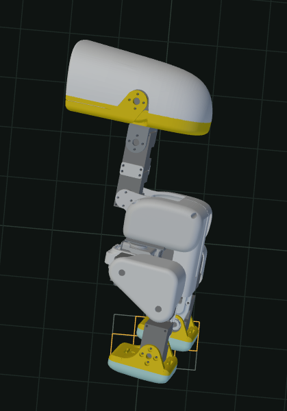
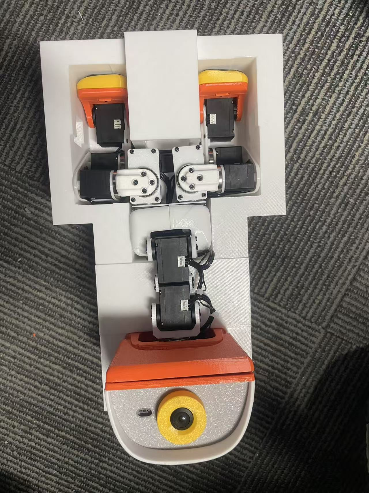
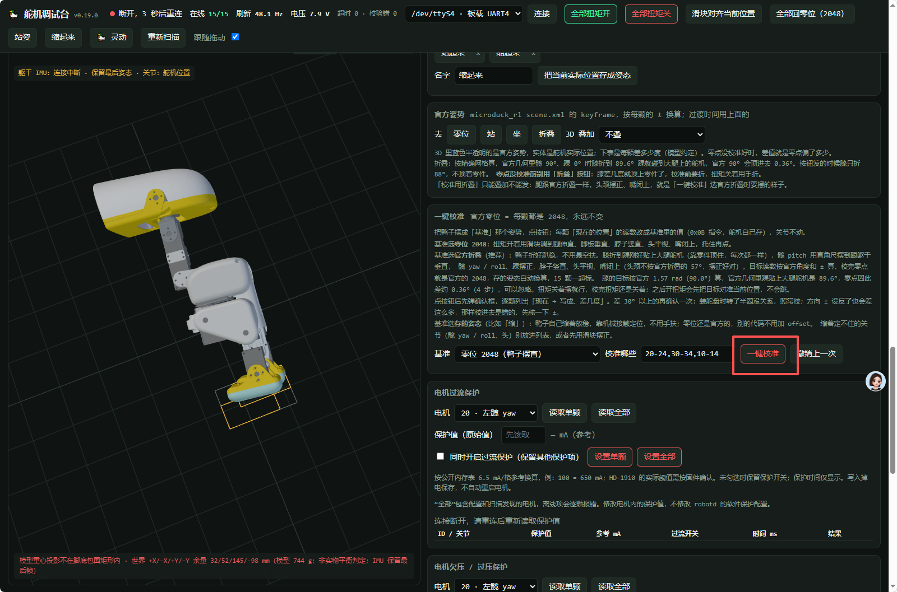

# Microduck · HD1910 + BNO085

**基于强化学习的小型双足机器人运行时，适配飞特 HD1910 舵机与 I²C BNO085 IMU。**

**简体中文** | [English](README.en.md)

[硬件与接口](#2-硬件与接口) · [模型与训练](#3-模型与训练) · [编译与部署](#4-编译与部署) · [使用说明](#5-使用说明) · [文档导航](#6-仓库结构与文档) · [致谢](#7-项目来源与致谢)

重新安装或更新软件：[重新部署软件](重新部署软件.md) → [校准](校准.md)。断连或刷机恢复见 [断开连接处理](断开连接处理.md)。

## 1. 项目简介

本工程 fork 自 [Pollen Robotics / microduck](https://github.com/pollen-robotics/microduck)，在其 Rust 运行时基础上适配 **飞特 HD1910 电机**，并将 IMU 改为通过 **I²C（IIC）连接的 BNO085**。

本工程使用 **Radxa ZERO 3W（2 GB 内存、无 eMMC，硬件版本 v1.1.2）**，通过 TF 卡运行 **Armbian 26.8.1 精简版**。机器人通过 ONNX 运动策略控制关节，默认控制频率为 50 Hz。仓库包含运动控制、硬件驱动、手柄输入、命令行工具、网页舵机调试工具和部署脚本。

| 项目 | 本分支内容 |
| --- | --- |
| 舵机 | 15 路飞特 HD1910，使用飞特总线驱动 |
| IMU | BNO085，通过独立 I²C 总线读取姿态与角速度 |
| 运动控制 | Rust 控制循环与 ONNX 策略推理 |
| 操作方式 | 蓝牙手柄、板端命令行、SSH 交互式键盘控制 |
| 调试工具 | 舵机网页调试台、状态监控、电流记录 |
| 训练流程 | 在独立训练仓库中训练并导出 ONNX，再部署到本运行时 |

本仓库主要负责实机运行与部署；配套训练仓库为 [MHDuck/microduck_rl](https://github.com/MHDuck/microduck_rl)。可执行的动作取决于已部署模型和配置。

## 2. 硬件与接口

以下为本工程使用的硬件与系统，接口配置见 [deploy/robotd.toml](deploy/robotd.toml)。接线与设备路径需要和实际硬件对应。

| 硬件 / 参数 | 当前设置 |
| --- | --- |
| 主控 | Radxa ZERO 3W / RK3566 |
| 内存 | 2 GB |
| 板卡硬件版本 | v1.1.2 |
| 存储与启动 | 无 eMMC，使用 TF（microSD）卡 |
| 板端系统 | Armbian 26.8.1 精简版 / ARM64 Linux |
| 平台选择 | `platform.variant = "open_microduck"` |
| 舵机型号与数量 | 飞特 HD1910 × 15 |
| 舵机驱动 | `bus.driver = "hd1910"` |
| 舵机串口 | `/dev/ttyS4`，1 Mbps |
| IMU 驱动 | `imu.driver = "bno085"` |
| IMU 总线 | `/dev/i2c-3` |
| IMU 地址 | `0x4B`；驱动接受 `0x4A` 或 `0x4B` |
| 控制频率 | 50 Hz |

> [!IMPORTANT]
> [fanhao375/microduck-replica](https://github.com/fanhao375/microduck-replica) 中提到的 **B1 引导 + B1 DTB + Armbian 6.1.115 内核**方案不适用于本工程上述硬件与系统组合。本工程按 Armbian 26.8.1 精简版的流程部署，无需套用该 B1 引导和设备树替换方案。

BNO085 驱动当前按传感器 **+X 朝上、+Y 朝左、+Z 朝后**处理安装方向。更改安装方向时，需要同步调整 [坐标变换](robotd/src/bno085.rs)，并检查机器人直立时的重力方向。

### 舵机编号

编号以 [关节映射](duck-control/src/model.rs) 为准：

| ID | 关节，按 ID 顺序 |
| --- | --- |
| 10 / 11 / 12 / 13 / 14 | 右髋偏航 / 右髋侧倾 / 右髋俯仰 / 右膝 / 右踝 |
| 20 / 21 / 22 / 23 / 24 | 左髋偏航 / 左髋侧倾 / 左髋俯仰 / 左膝 / 左踝 |
| 30 / 31 / 32 / 33 | 颈部俯仰 / 头部俯仰 / 头部偏航 / 头部侧倾 |
| 34 | 嘴部 |

ONNX 输出控制其中 14 个关节，嘴部单独控制。模型数组顺序不等于舵机 ID 顺序；部署前应核对 ID、零位、正方向以及训练使用的默认姿态。

## 3. 模型与训练

本工程的配套训练仓库为 **[MHDuck/microduck_rl](https://github.com/MHDuck/microduck_rl)**，训练环境配置、模型训练与 ONNX 导出方法请查阅该仓库。

训练工程上游来源为 [pollen-robotics/microduck_rl](https://github.com/pollen-robotics/microduck_rl)，训练适配参考 [LuwuDynamics/xgoduck_rl](https://github.com/LuwuDynamics/xgoduck_rl)。

本运行时使用的模型接口为：

```text
obs [1, 61] → ONNX policy → actions [1, 14]
```

除输入输出维度外，观测顺序、关节顺序、默认姿态、动作缩放和电机参数也需要与训练一致。其他硬件平台的模型不能仅凭维度相同就视为兼容。

当前 [策略配置](deploy/robotd.toml) 引用：

| 配置项 | 模型 / 设置 | 用途 |
| --- | --- | --- |
| `walk` | `walk_hd1910_flat_v5.onnx` | 行走 |
| `sitstand` | `sitstand_hd1910.onnx` | 坐下 / 站起 |
| `stand` | `"none"` | 未启用独立站立策略 |
| `ground_pick`、`kick_left`、`kick_right`、`roulade` | `"none"` | 未启用对应动作策略 |

> [!IMPORTANT]
> 当前源码中的默认模型路径与随附文件尚未完全对齐：上述行走、坐站文件缺失，打包脚本还引用了缺失的 `policies/kp30.onnx`。部署前需要补齐对应文件，或同步调整策略路径与打包清单。仓库内其他 ONNX 文件不会自动替换这些模型。

模型放在 [policies/](policies/)，板端路径通过 `/etc/robot/robotd.toml` 的 `[policy]` 配置。文件来源说明见 [policies/README.md](policies/README.md)；打包清单见 [scripts/dev-push.sh](scripts/dev-push.sh)。修改策略路径后需重启 `robotd`。

## 4. 编译与部署

**重新部署顺序：安装 PC 依赖 → 配置 Rust / Zig → 部署 RK3566 环境 → 推送模型和配置 → 网页校准。** 以下命令同时适用于 PC 原生 Ubuntu 和 WSL Ubuntu；详细依赖用途、板端软件清单及排错见 [重新部署软件](重新部署软件.md)。

### 4.1 板端首次上电

将 **Armbian 26.8.1 精简版**写入 TF 卡，插入主板并上电。按首次启动提示设置**用户名、密码和 Wi-Fi 信息**，确认电脑可以通过 SSH 登录主板，且该账号具有 sudo 权限。

下文以 `radxa@192.168.2.90` 为例；请替换为首次启动时设置的用户名和主板实际 IP。

### 4.2 PC 端准备 WSL Ubuntu 环境

在 PC 的 **Ubuntu / WSL Ubuntu** 中操作，下面的统一准备清单以 **Ubuntu 24.04 LTS** 为基线。需要更换国内源时，按[清华大学 Ubuntu 镜像使用说明](https://mirrors.tuna.tsinghua.edu.cn/help/ubuntu/)选择与本机 Ubuntu 版本一致的配置。

先启用 Universe 软件源，再一次安装本项目 SSH 部署、本机构建和开发检查使用的 APT 软件包；间接依赖由 APT 自动安装：

```bash
sudo apt update
sudo apt install -y software-properties-common
sudo add-apt-repository -y universe
sudo apt update
sudo apt install -y \
  git curl ca-certificates openssh-client \
  build-essential pkg-config cmake binutils \
  gcc-aarch64-linux-gnu g++-aarch64-linux-gnu libc6-dev-arm64-cross \
  python3 python3-venv python3-pip \
  libudev-dev libdbus-1-dev libssl-dev \
  libgstreamer1.0-dev libgstreamer-plugins-base1.0-dev libgstreamer-plugins-bad1.0-dev \
  nodejs npm \
  bash coreutils findutils grep sed gawk tar gzip xz-utils zstd unzip file
```

克隆或更新本仓库，进入仓库根目录。APT 不负责安装本项目使用的 Rust / Zig 工具链，还需执行：

```bash
bash setup-build.sh
source "$HOME/.cargo/env"
rustup target add aarch64-unknown-linux-gnu
cargo fetch --locked
```

Rust 版本要求为 1.89 或更新版本。`setup-build.sh` 配置 Rust、Python 虚拟环境、`cargo-zigbuild` 与 `ziglang==0.14.1`，使用国内 Rust 镜像和清华 PyPI 镜像。ARM64 的 GStreamer / udev 库由部署脚本准备独立 sysroot，不能用 PC 的同名库代替。各包用途、可选的 PC 蓝牙支持和非 APT 依赖见 [完整软件清单](重新部署软件.md#pc-packages)。

### 4.3 部署系统服务

先完成模型准备，并核对 [deploy/robotd.toml](deploy/robotd.toml) 中的串口、IMU 和策略配置。在 **PC 的 Linux / WSL 终端**中，从仓库根目录执行：

```bash
bash scripts/provision-board.sh \
  --pause-btd-on-pair \
  --name Ducky \
  radxa@192.168.2.90
```

脚本从当前源码构建并打包服务，初始化或刷新板端环境；过程中可能重启主板。`--pause-btd-on-pair` 配置手柄配对兼容行为，在配对期间暂停 `btd`；`--name Ducky` 设置机器人名称。脚本会为本地构建准备签名密钥，私钥保存在仓库外，并安装 `servo-web` 校准网页服务。

板端已有 `/opt/robot/daemon/current` 时，此步骤刷新环境而不替换现有运行时版本，仍需继续下一步推送。脚本不会自动更新 PC 上的源码和模型；“最新”指本机已准备好的版本。失败时先按 [部署排错](重新部署软件.md#deploy-errors) 处理，成功后再继续。

### 4.4 下发模型和程序

系统服务部署完成后，在 **PC 的 Linux / WSL 终端、仓库根目录**执行：

```bash
bash build.sh
sh xh_push.sh radxa@192.168.2.90
```

上传入口为仓库根目录的 [xh_push.sh](xh_push.sh)。`bash build.sh` 生成 `target/native/aarch64-unknown-linux-gnu/release/robotd`；已有最新编译产物时，可直接执行上传命令。

上传脚本下发 `robotd`、`policies/*.onnx`、控制 / 诊断脚本与 `deploy/robotd.toml`，校验程序和配置的 SHA-256，并重启 `robotd`。不带 `--build` 的 `xh_push.sh` 不会自动编译，所以源码更新后先执行上面的 `bash build.sh`。

**上传会覆盖板端 `/etc/robot/robotd.toml`。** 板端调试后的参数应先同步回本地配置。后续更新程序或模型也使用上述命令。

### 4.5 保护 TF 卡上的引导配置

本工程使用 TF 卡时曾遇到断电后 `/boot/armbianEnv.txt` 损坏、系统无法启动的情况。**部署完系统服务并确认主板正常启动后**，在板端执行：

```bash
sudo chattr +i /boot/armbianEnv.txt
lsattr /boot/armbianEnv.txt
```

确认属性中出现 `i`。它将文件设为不可变（immutable），阻止改写或删除，详见 [chattr 手册](https://man7.org/linux/man-pages/man1/chattr.1.html)。这能防止误写，但不能保证 TF 卡在异常断电后不损坏；使用完毕请先执行 `sudo poweroff`，待主板关机后再断电。

后续需要修改引导参数、设备树配置，或执行会更新该文件的系统维护时，先在板端解除保护：

```bash
sudo chattr -i /boot/armbianEnv.txt
```

维护完成后，再执行 `sudo chattr +i /boot/armbianEnv.txt` 恢复保护。首次部署需要写入引导配置，请在部署完成后设置该属性。

### 4.6 检查运行状态

安装或更新后，在板端检查：

```bash
robotctl health
robotctl monitor
journalctl -u robotd -b -n 80 --no-pager
```

### 4.7 部署完成后进行网页校准

先托稳机器人，在 **RK3566 的 SSH 终端**运行：

```bash
sudo systemctl restart servo-web
```

启动调试台会停止 `robotd`、`padd`、`mediad` 和 `tofd`。在 **PC 浏览器**打开 [校准网页](http://192.168.2.90:8081/)，确认设备已连接、位置持续刷新，标准整机应有 15 颗舵机在线。IP 按实机替换。

把真机摆成下图的零位：**双腿伸直、不外撇，脚底与小腿成直角，脖子竖直，头部平视朝前，嘴闭合**。手动摆动前先支撑并关闭相应舵机扭矩，不硬掰有力的关节。难以保持姿态时，可使用我们的校准工装辅助固定。

<p> </p>

在网页“一键校准”区域选择 **“零位 2048（鸭子摆直）”**，核对校准列表，然后点击 **“一键校准”**，检查弹出的逐颗预览并确认。**工装实际固定的姿态必须与基准一致；若固定为折叠姿态，不能套用摆直零位，需按 [校准说明](校准.md#fixture) 选择匹配基准。** “全部回零位（2048）”是运动按钮，不是校准按钮。

<p></p>

上图是按钮位置示例，截图中的“断开”和保留姿态不是可执行校准的状态。校准完成后查看成功 / 失败列表，再按 [校准文档](校准.md) 验证和恢复控制；图中姿态、工装、完整界面及操作细节均在该文档中。

**校准保存与换板：** 实际零点写在每颗舵机的 EEPROM 中；板端默认的 `~/microduck/tools/servo-web/calib/eeprom-*.json` 是校准前的偏移备份，用于撤销。同一只 duck 只换 RK3566，校准随原舵机保留；另一只 duck 使用另一套舵机时，应重新校准，不能套用旧备份。实际目录、结果日志和迁移说明见 [校准文件与 RK3566 迁移](校准.md#calibration-migration)。

## 5. 使用说明

首次使能前应支撑好机器人，确认关节零位、IMU 姿态和模型配置正确。

### 蓝牙手柄

让手柄进入配对模式，在板端执行：

```bash
sudo robotctl pad pair
robotctl pad status
```

配对后由 `padd` 读取手柄输入，`robotd` 执行运动控制。常用操作如下，按键名称以 Xbox 手柄为例：

| 按键 | 功能 |
| --- | --- |
| Start | 启用 / 停用运动策略；停用策略不等于关闭舵机力矩 |
| 左摇杆 | 前进、后退、左右横移 |
| 右摇杆左右 | 转向 |
| Y | 切换头部控制模式 |
| B | 切换身体姿态模式 |
| 方向键下 | 坐下 / 站起，需要 `sitstand` 模型 |
| RT / LT | 嘴部与声音控制 |

动作按键存在并不表示相应模型已经配置。完整配对与排障说明见 [手柄文档](docs/robot/pair-a-gamepad.md)。

### SSH 键盘控制

在板端的交互式终端运行：

```bash
sudo systemctl stop padd
sudo systemctl start robotd
sudo python3 /opt/robot/daemon/current/scripts/keyboard-control.py
```

启动脚本前托住机器人：脚本先关闭策略，通过 `robot.init` 在约 2 秒内平滑回到 stand
（HOME 固定站姿），等待 Enter。当前部署配置只加载 walk，按 Enter 后零速度也运行 walk；
再次按 Enter 停止模型并回到 stand，保持力矩。此配置下 T/G/Z/V/X 的动作模型未启用。
修改后需同时上传脚本和 `deploy/robotd.toml` 并重启 `robotd`；该模型配置也适用于手柄。

| 键盘 | 对应手柄 | 功能 |
| --- | --- | --- |
| Enter | Start | 开启 / 关闭运动策略，由 `robotd` 切换实际状态；关闭策略不卸力 |
| W / S、A / D | 左摇杆 | 行走模式下增减前后 / 横移速度，每次 0.10 m/s，范围 ±0.40 m/s；松开保持 |
| Q / E | 右摇杆左右 | 保留左右转向，松开约 0.3 秒停止转向 |
| T | 方向键下 | 坐下 / 站起，保留之后 5 秒的关节位置打印 |
| Y / B | Y / B | 切换头部 / 身体姿态模式，再按同键返回行走；切换时速度归零 |
| G | A | 地面拾取（A 保留给方向控制） |
| Z / V | LB / RB | 左 / 右踢腿 |
| X | X | 前滚翻，长按连续翻滚 |
| R / F | RT / LT | 张嘴；R 触发叫声，F 按住播放 wheee；松开后关闭 |
| M 长按 3 秒 | 方向键上长按 | 请求切换步行 / 轮式；方向键的速度调整方式不变 |
| P 长按 2 秒 | Select 长按 | 请求关机；当前仅 walk 配置会直接卸力，请先托住机器人 |
| 空格 | — | 速度归零、姿态目标归零，并释放嘴部、声音和连续翻滚输入 |
| C | — | 开始 / 停止电流 CSV 记录 |
| H | — | 开启 / 关闭行走发声；R/F 手动发声期间暂停自动语音 |
| Esc / Ctrl-C | — | 退出并卸力；默认连接下还会停止 `robotd`，退出前应托住机器人 |

头部模式：W/S 控制头部俯仰，A/D 控制头部偏航，I/K 控制颈部俯仰，J/L 控制头部侧倾。
每次调整 0.10 rad，范围 ±2.5 rad。身体姿态模式：W/S 调整高度（每次 0.001 m，范围
−0.025～+0.010 m），I/K 调整俯仰，J/L 调整侧倾（每次 0.02 rad，范围 ±0.2618 rad）。
姿态按键松开后保持目标，空格归零；这两个模式下机器人不接收行走速度。

终端没有按键松开事件，脚本通过按键重复估算长按；R/F/X 松开约 0.3 秒释放，
Enter、Y/B、T、G、Z/V、C、H 两次点按需间隔 1 秒以上，以免长按被当成反复切换。
M/P 单次长按只触发一次。动作缺少模型时显示拒绝原因，保留键盘会话。
先停 `padd` 是为了避免手柄与键盘争抢指令；恢复手柄控制时执行 `sudo systemctl start robotd padd`。

`--walk-voice` 可在启动时开启行走发声，`--voice-sound-only` 关闭自动语音的嘴部动画，
手动 R/F 仍控制嘴部。独立语音、视觉诊断和 StandUp 测试见
[本地部署增量](docs/LOCAL_CUSTOMIZATIONS.md)。

### 网页调试与保护设置

[servo-web](tools/servo-web/README.md) 用于舵机调试。启动该服务会停止 `robotd`、`padd`、`mediad` 和 `tofd`。调试结束后，支撑好机器人再恢复手柄控制：

```bash
sudo systemctl stop servo-web
sudo systemctl start robotd padd
```

<a id="飞特分支倾倒保护与电流保护"></a>

运行时提供倾倒和过流锁定停机功能，但当前 [deploy/robotd.toml](deploy/robotd.toml) 中 `fall_protection` 与 `overcurrent_protection` **均为 `false`**。该设置与独立的 `limp_fall` 降增益逻辑不同。

启用锁定停机后，保护触发会关闭舵机力矩；需要支撑并扶正机器人、排除故障，再重启 `robotd`。过流判断使用舵机供电电流估算，阈值需要结合实际电源和负载标定。独立舵机调试工具不经过 `robotd` 的这套保护。

## 6. 仓库结构与文档

| 路径 | 内容 |
| --- | --- |
| [robotd/](robotd/) | 运动控制服务、动作调度与 BNO085 接入 |
| [duck-control/](duck-control/) | 舵机总线、观测构建、ONNX 推理与保护逻辑 |
| [robotd-params/](robotd-params/) | 运行参数与配置解析 |
| [padd/](padd/)、[robotctl/](robotctl/)、[duckctl/](duckctl/) | 手柄服务、板端 CLI、电脑端客户端 |
| [configd/](configd/)、[btd/](btd/)、[mediad/](mediad/)、[tof/](tof/) | 网络与配对、BLE、音视频、ToF 服务 |
| [policies/](policies/) | ONNX 策略与来源说明 |
| [deploy/](deploy/)、[scripts/](scripts/) | 板端配置、安装与部署脚本 |
| [tools/servo-web/](tools/servo-web/) | 舵机网页调试工具 |
| [docs/](docs/) | 操作、架构与开发文档 |

常用文档：[重新部署软件](重新部署软件.md) · [校准](校准.md) · [中文入门指南](Microduck入门指南.md) · [故障排除](故障排除.md) · [断开连接处理](断开连接处理.md) · [命令速查](docs/robot/cheatsheet.md) · [系统架构](docs/design/architecture.md) · [开发指南](CONTRIBUTING.md) · [文档索引](docs/README.md)。

部分文档沿用上游平台和示例参数；本分支的硬件配置以当前源码及 `deploy/robotd.toml` 为准，已部署设备以 `/etc/robot/robotd.toml` 为准。

## 7. 项目来源与致谢

感谢以下项目作者与贡献者。本工程的来源与参考关系如下：

| 项目 | 关系 |
| --- | --- |
| [pollen-robotics/microduck](https://github.com/pollen-robotics/microduck) | 本工程的上游仓库，提供 Microduck 运行时基础 |
| [fanhao375/microduck](https://github.com/fanhao375/microduck) | 硬件与运行时适配参考 |
| [LuwuDynamics/xgoduck_runtime_arduino](https://github.com/LuwuDynamics/xgoduck_runtime_arduino) | 运行时适配参考 |
| [pollen-robotics/microduck_rl](https://github.com/pollen-robotics/microduck_rl) | 训练工程来源 |
| [LuwuDynamics/xgoduck_rl](https://github.com/LuwuDynamics/xgoduck_rl) | 训练适配参考 |

## 8. 参与贡献与许可

欢迎通过 GitHub Issues 反馈问题，或通过 Pull Request 提交改进。反馈实机问题时，请附上主板与系统版本、舵机和 IMU 型号、相关配置、模型文件名以及复现步骤。开发约定见 [CONTRIBUTING.md](CONTRIBUTING.md)。

根目录保留上游的 [Apache License 2.0](LICENSE)。部分文件另有许可声明：[BNO085 驱动](robotd/src/bno085.rs) 和 [网页调试传感器模块](tools/servo-web/board_sensors.py) 标注为 **GPL-3.0-or-later**，相关来源和许可副本见 [NOTICE-board.md](tools/servo-web/NOTICE-board.md)。

请同时查阅各文件、第三方组件及模型的许可说明；不能将根目录 LICENSE 视为所有内容的统一许可。本 README 不变更现有版权或授权声明。
