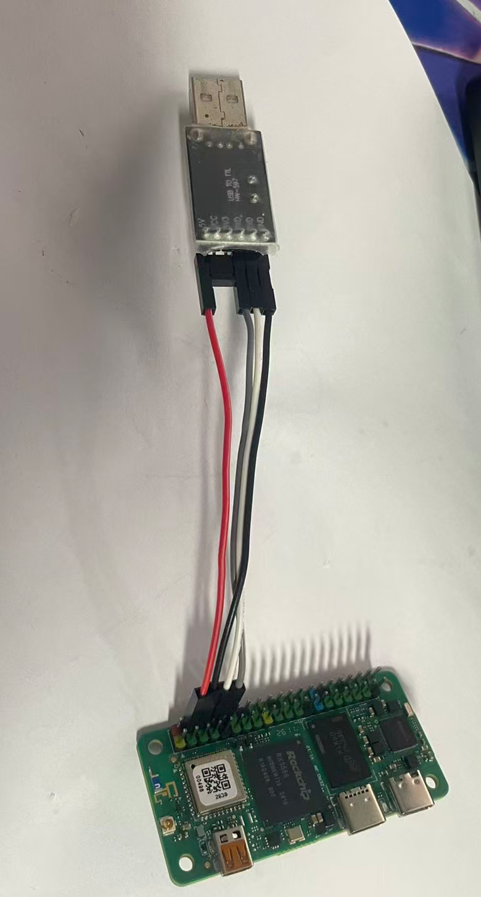

# MHDuck 断开连接处理

更新：2026-10-23。适用于使用 RK3566 / Radxa Zero 3W、飞特舵机和标配电池的 MHDuck。

遇到 SSH 断连，先按下面两类排查：**开机能连、开始动作后断连**，优先检查电池和供电接触；**开机一直连不上**，先检查 Wi-Fi、实际 IP 和主板供电，再查 TF 卡与系统。不要一断连就重刷系统。

| 当前现象 | 先做什么 |
| --- | --- |
| 一启动动作就断连，过一会儿又能登录 | [检查是否重启，再查电池和供电](#after-motion) |
| 机身一动就断连，充满电也一样 | [检查接头与线束](#wiring) |
| 运行一段时间后变慢、发热、断连 | [检查温度与日志](#temperature) |
| 从开机起就无法 SSH | [检查网络、供电与 TF 卡](#no-ssh) |
| 网络排除后仍无法启动 | [用 USB 转 TTL 查看启动日志](#serial) |
| 已确认系统损坏且无法修复 | [备份并重新烧录系统镜像](#reflash) |

## 1. 先稳住机器人，再判断断在哪里

断连后先扶稳机身，手指避开关节，不依赖已经断开的终端停止动作。还能通过另一窗口登录时，可在**机器人 SSH 终端**停止控制：

```bash
sudo systemctl stop robotd
```

停止服务可能让机器人失去支撑，执行前先托住。无法登录且仍有危险动作时，按交付说明切断电源；能够正常操作系统时，优先 `sudo poweroff` 后再断电。

### 1.1 查看电池和温度的正确命令

在能 SSH 且 robotd 正常运行时执行：

```bash
sudo robotctl health
```

命令是 **`robotctl health`**，不是 `systemctl robotctl health`。`systemctl` 用于查看、启动或停止系统服务，例如 `systemctl status robotd`。

| 输出字段 | 含义 |
| --- | --- |
| `battery` | 舵机总线电压及估算电量百分比 |
| `cpu` | 主板温度读数，用于排查 RK3566 发热 |
| `motors` | 舵机最高温度、对应关节及平均温度，与主板温度分开判断 |

当前程序的电压读数经过约 10 秒时间常数的平滑处理，**可能捕捉不到电机启动瞬间的压降**。百分比也是估算，不能因为还没显示 0% 就排除供电不足。

若显示 `robot unavailable` 或没有电压字段，先看 `systemctl status robotd --no-pager -l`。服务停止、总线没有有效读数都可能导致查不到电压；**没有读数不等于电池是 0V**，也不要为了取得读数直接启用运动。

### 1.2 判断主板是否真的重启

正常连接时记下以下输出；断连恢复后再执行一次：

```bash
uptime
cat /proc/sys/kernel/random/boot_id
```

- `boot_id` 改变，说明主板经历了新的系统启动；`uptime` 变成刚启动几分钟，也支持重启判断。接着检查供电、温度和启动日志。
- `boot_id` 未变，说明没有重启，优先看 Wi-Fi、SSH 服务或系统负载；这仍不能仅凭一项就确定根因。
- SSH 一直正常，只有机器人控制程序断开，先查看 robotd 服务和日志，按 [故障排除](故障排除.md) 处理。

<a id="after-motion"></a>

## 2. 开机能 SSH，一开始动作就断连

### 2.1 优先检查电池是否需要充电

**典型现象：** 主板能启动、能连接 Wi-Fi 和 SSH，但一开启舵机或执行动作就断连，随后主板重新启动。

**可能原因：** 电池还能支撑主板启动，却不能承受电机启动时的大电流。带载后电压明显下降，可能导致主板供电不足或电池保护动作，RK3566 因此重启。电池老化、插头接触电阻大也可能造成类似现象。

**电压怎么判断：** MHDuck 标配电池的标称电压为 **7.4V**，充满约 **8.4V**。按本机使用经验，读数到 **7.5V 附近且开始出现动作后断连**，应优先停止动作、充电或换一块已知正常的满电电池排查。这里的 7.5V 是本机排查参考，不是所有电池统一的“电量归零”阈值；7.4V 也不是允许一直用到的最低电压。

**处理步骤：**

1. 保持机器人不动作，保存 `sudo robotctl health` 输出和是否重启的记录。
2. 正常关机，切断电源，使用配套充电器充电；或更换同规格、已充满且已知正常的电池。
3. 重新上电，先确认静止状态下 SSH 稳定，再在有人支撑、远离桌沿的条件下做短时验证。
4. 换电池后问题消失，说明供电能力是重要线索；如果仍复现，继续检查电池座、供电接头和线束，不反复用动作触发重启。

**判断边界：** 空载测到 8V 多也不能保证电池带载正常。需要进一步定位时，应比较电池端、主板供电端在负载变化时的电压；普通万用表和软件采样都可能漏掉很短的跌落。

<a id="wiring"></a>

### 2.2 检查是否有松动、接触不良或断线

**典型现象：** 静止时正常，一动头、动腿或机身振动就断连；充电后仍然发生。

**排查顺序：** 电池与电池座接触点 → 电源开关和主供电线 → HAT / 主板供电接头 → 舵机供电线束。重点看插头有没有插到底、端子有没有退针、线皮是否破损、线束是否被关节夹住或动作时拉紧。

先正常关机，断开电池、USB 等所有电源，再逐个检查、重插和轻拉确认。不要带电摇晃线束找断点。如果需要打开头壳检查主板附近接头，先拍照记录接法，装回时避免压线。

**万用表检查方法：**

- 查导通：全部断电后，用通断档逐段检查导线与接头；**不在带电电路上使用通断档或电阻档**。
- 查电压：黑表笔插 `COM`，红表笔插 `V/Ω`，选择覆盖 8.4V 的直流电压档；量同一接头的 `VCC` 与 `GND`。不要把表笔插在电流孔后跨接电源，也不要让探针短接相邻针脚。
- 先断电定位和固定探针，再上电读取；需要移动到下一个接头时先断电。只在能明确识别针脚且有绝缘保护时操作，不熟悉测量或拆机的用户交由售后处理。

对比各段：上游有电、下游没有或明显偏低，才沿这段线继续查。不要只按线的颜色猜针脚，飞特与其他舵机接口的定义可能不同。

**区分故障范围：** 单根舵机的信号线或其独立供电支路断开，通常首先表现为舵机离线，不一定让主板无法 SSH。整机掉线更应关注共同供电路径、主板供电、短路或重启；不要仅因 SSH 不通就认定某颗舵机线断了。

<a id="temperature"></a>

### 2.3 运行一段时间后温度过高

先查看 `sudo robotctl health` 中的 `cpu` 与 `motors`，不要把舵机温度当成主板温度。robotd 不可用但系统仍能登录时，可直接读取内核温度节点：

```bash
grep -H . /sys/class/thermal/thermal_zone*/type /sys/class/thermal/thermal_zone*/temp
sudo journalctl -k -b --no-pager | grep -Ei 'thermal|throttl|overheat|critical temperature'
```

`temp` 通常以毫摄氏度表示，例如 `75000` 表示 75℃；这是单位示例，不是统一的故障阈值。结合对应 `type` 判断传感器。

**处理：** 停止动作并托稳机器人，检查散热片、通风口和已安装风扇是否正常，关机冷却后再测。不要为排查断连提高摄像头检测频率或同时运行高负载测试。

**不要直接下结论：** 温度高可能触发降频，表现为卡顿；降频本身不等于 SSH 一定断连。达到内核配置的临界温度时可能关机或重启，需要结合 `boot_id`、温度与日志确认，不能仅凭摸起来热判断。温度接口和临界保护行为见 [Linux 内核热管理文档](https://docs.kernel.org/6.12/driver-api/thermal/sysfs-api.html)。

<a id="no-ssh"></a>

## 3. 开机后一直连接不上 SSH

### 3.1 先确认 Wi-Fi 信息和实际 IP

1. 确认电池有电、设备已上电，等待系统启动约 1～3 分钟。
2. 检查手机热点或路由器的名称、密码是否仍与机器人保存的信息一致；按交付说明使用对应网络。
3. 在热点已连接设备列表或路由器管理页面查找机器人，确认当前 IP，不沿用以前的地址。
4. 让电脑连接同一网络，并确认热点允许连接设备之间互访。
5. 在**电脑端**使用 IP 登录，把占位符替换成实际地址：

```bash
ssh radxa@<机器人IP>
```

| 看到的情况 | 下一步 |
| --- | --- |
| `radxa.local` 解析失败，但 IP 能登录 | 是主机名解析问题，先用 IP；无需重刷 |
| 热点列表没有机器人 | 继续确认 Wi-Fi 信息、兼容模式和供电；也可能系统尚未启动，不能只判定密码错误 |
| `Connection timed out` | 确认 IP、网络互访和设备是否在线；必要时通过串口检查 |
| `Connection refused` | 确认连接的是机器人；若 IP 正确，通过串口检查 SSH 服务 |
| `Permission denied` | 网络已通，核对用户名及当前密码 |

若热点更名或改密码后失联，可先恢复原热点配置以重新取得连接，再按 [入门指南的 Wi-Fi 修改步骤](Microduck入门指南.md#4-修改机器人保存的-wi-fi可选) 操作。不要在尚未恢复连接时盲改多套网络配置。

### 3.2 排除主板供电和内部接线

按 [接线检查](#wiring) 确认电池、主电源线与主板供电路径。绿灯闪烁只能作为线索，不能单凭灯效认定系统已经正常启动或系统已经损坏。

必要时拆开头壳检查接头、供电和卡座。测舵机接头电压可以定位舵机供电线断点，但**不能代替主板供电检查**。需要检查哪根线，应按实机供电接法判断。

### 3.3 检查 TF 卡是否松动，再考虑系统损坏

设备完全断电后重新插好 TF 卡，检查卡是否到位、接点或卡座是否损坏。不要在运行时拔卡。

重新上电仍然无网络时，接串口记录启动过程：可能是卡未识别、读写错误、引导配置损坏、根文件系统挂载失败，也可能系统已起来但网络没配置好。先区分，再决定修复或重刷。

**插到 Windows 后如果提示“需要格式化才能使用”，先取消。** Linux 分区不能被 Windows 直接识别不等于卡坏了；格式化会破坏原系统。原卡有配置或日志需要保留时，优先备份，或用另一张卡验证恢复镜像。

<a id="serial"></a>

## 4. 用 USB 转 TTL 查看启动日志

适用于网络不可用、需要判断系统卡在哪一步的情况。这里使用 GPIO 上的 UART 调试口，不是舵机半双工总线，也不是主板 USB gadget 串口。

### 4.1 准备工具与接线

准备支持 **3.3V TTL 逻辑电平、1,500,000 波特率**的 USB 转 TTL 模块、杜邦线和 PuTTY 等串口工具。模块的“3.3V 电源输出”不一定代表 TX 信号也是 3.3V，须核对模块说明。

主板先断电，按 **40 针排针的物理针号**连接，不按 GPIO 编号或线色猜：

| Radxa Zero 3W | USB 转 TTL |
| --- | --- |
| Pin 6：GND | GND |
| Pin 8：TX | RXD |
| Pin 10：RX | TXD |

**只接 GND、TX、RX 三根信号线，USB 转 TTL 的 5V / 3.3V / VCC 电源脚不接主板。** 主板通过已确认正常的供电路径单独供电，避免把电脑 USB 电源与电池 / HAT 供电叠加。连接器朝向、针号和串口参数依据 [Radxa 官方串口调试说明](https://docs.radxa.com/en/zero/zero3/low-level-dev/serial)。

维护者提供的实物照片如下，仅用于识别工具和主板；照片包含额外连线，**不要照着照片的线色或四线接法通电，以本节三线表为准**。

<p></p>

### 4.2 打开串口并记录从上电开始的输出

1. USB 转 TTL 插入电脑，在设备管理器确认 COM 口；没有 COM 口时先按模块型号安装驱动。
2. PuTTY 选择 **Serial**，填写实际 COM 口，设置 **1500000 baud、8 数据位、1 停止位、无校验、无流控**。
3. 打开串口窗口并开启日志保存，再给主板上电，保留从第一行开始的完整输出。
4. 若出现登录提示，使用该镜像的账号密码登录；检查网络和 SSH 服务，不必先启用 robotd 或电机。

没有输出时先核对 COM 口、交叉连接、共地、逻辑电平和模块是否支持 1.5 Mbps。乱码先核对波特率。只有部分启动输出而没有登录提示，也可能是镜像关闭了内核串口控制台或串口登录服务，不能据此直接认定 TF 卡损坏。当前项目曾配置过串口用途，实际行为以镜像为准。

### 4.3 根据日志决定下一步

| 日志现象 | 优先检查 |
| --- | --- |
| 启动信息反复从头出现 | 供电、复位或看门狗；结合每次重启前最后几行判断 |
| 多次 `mmc` 超时、`I/O error`，伴随读卡失败 | TF 卡接触、读卡稳定性与供电，不先假定只是软件问题 |
| `Unable to mount root fs`、`EXT4-fs error`、进入 `emergency mode` | 根分区、文件系统与引导配置；先备份再针对具体错误修复 |
| 已到登录界面，网络没有 IP | Wi-Fi 配置、DHCP 和当前网络管理后端 |
| 系统和 IP 正常，但 SSH 拒绝连接 | `systemctl status ssh --no-pager -l` 与 `journalctl -u ssh -b --no-pager`；服务名称按镜像实际配置确认 |

可把完整日志交给售后或 GPT 辅助定位，建议这样说明：

```text
设备：MHDuck，Radxa Zero 3W / RK3566，TF 卡启动。
现象：[从开机就无法 SSH / 动作后断连 / 反复重启]。
电源与已做检查：[电池电压、是否换满电电池、接头是否检查]。
下面是从上电开始的完整串口日志，请先判断卡在引导、内核、文件系统还是网络阶段。
先给只读排查步骤；涉及文件系统修复或重刷时，先说明备份位置和具体目标分区。
[粘贴日志，不包含密码]
```

不要在仍挂载使用的根分区上直接执行文件系统修复；需要离线修复时，先确认设备与分区。若仍能进入系统，涉及 `/boot/armbianEnv.txt` 的维护还需检查是否设置了不可变属性，见 [故障排除的启动与 TF 卡部分](故障排除.md#boot)。

<a id="reflash"></a>

## 5. 无法修复时，重新烧录系统镜像

先排除电池、线束和 TF 卡接触问题；否则重刷后仍会再次断连或损坏。优先使用另一张状态正常、容量足够的 TF 卡验证，并保留原卡。

### 5.1 下载维护者提供的镜像

| 项目 | 内容 |
| --- | --- |
| 压缩镜像文件 | `rk3566-py-26-10-20.img.xz` |
| 下载地址 | [MHDuck 系统镜像（百度网盘）](https://pan.baidu.com/s/1ARiiqr0gwqnmFNjCpvN5-Q) |
| 提取码 | `3w1e` |
| 解压后的镜像 | `rk3566-py-26-10-20.img` |

链接、提取码与文件名由维护者提供。本次整理未核验网盘内文件、镜像校验值或烧录启动结果；若分享失效、文件名不同或不确定是否适配当前硬件，向维护者确认后再写卡。

### 5.2 在 Windows 上烧录

1. **先备份。** 烧录会覆盖目标 TF 卡的系统与数据，包括 Wi-Fi、板端配置、模型和日志。原卡还能读取时先备份需要保留的内容；至少保留 `/etc/robot/robotd.toml` 和本机校准 / 姿态资料。
2. 将 `.img.xz` 完整解压为 `.img`。可使用支持 XZ 的 [7-Zip](https://www.7-zip.org/)；不要只修改扩展名，也不要把压缩文件直接复制进 TF 卡当作烧录。电脑磁盘要有足够空间容纳解压后的镜像。
3. 安装并打开 [Win32 Disk Imager](https://sourceforge.net/projects/win32diskimager/)（`win32diskimager.exe`）。该工具写入原始磁盘镜像，在 **Image File** 中选择解压后的 `rk3566-py-26-10-20.img`。
4. 插入读卡器，在 **Device** 中选择对应 TF 卡盘符；对照盘符与容量确认目标，必要时先拔掉无关 U 盘。目标卡实际容量必须容得下完整镜像，同标称容量的卡也可能略有差别。
5. 再确认目标卡，点击 **Write**，等待完成，过程中不要拔卡或断开读卡器。有 **Verify Only / 校验**功能时执行写后校验；若报错，先检查下载、解压、读卡器和卡，不直接忽略。
6. 完成后安全弹出读卡器，把 TF 卡装回已断电的机器人。Windows 再次提示格式化 Linux 分区时仍选择取消。

### 5.3 恢复后先检查，再运行动作

使用有足够电量的电池上电，按该镜像的交付说明准备 Wi-Fi / 热点，等待启动，再从热点或路由器确认 IP。旧卡上的 Wi-Fi、密码和参数不保证在新镜像中保留。

重新 SSH 后，先检查：

```bash
uptime
systemctl status robotd --no-pager -l
sudo robotctl health
```

核对当前串口、IMU、模型、舵机方向和零位与这台机器人匹配，先确认静止连接稳定，再在支撑条件下逐步验证动作。不要因镜像能开机就直接套回整份旧配置或认为所有硬件已修复。重装后出现 SSH 主机密钥变化时，确认确实是这台重刷的设备，再清理对应旧记录。

## 6. 发给售后的信息

请提供：**断连发生在开机还是动作后、断连前电池电压与温度、是否换过满电电池、重连后 uptime / boot_id、接线检查结果**。系统无法启动时附完整串口日志和镜像文件名。

还能 SSH 时可补充：

```bash
sudo journalctl -u robotd -b -n 100 --no-pager
sudo journalctl -k -b -n 100 --no-pager
sudo journalctl --list-boots
```

如果列表中存在上一次启动，可用 `sudo journalctl -k -b -1 -n 100 --no-pager` 查看上次内核日志。日志未持久保存或突然掉电时，上次记录可能不存在；不能因没有掉电报错就排除供电问题。

其他模型、舵机、语音和摄像头问题见 [故障排除](故障排除.md)，日常连接与控制见 [Microduck 入门指南](Microduck入门指南.md)。
