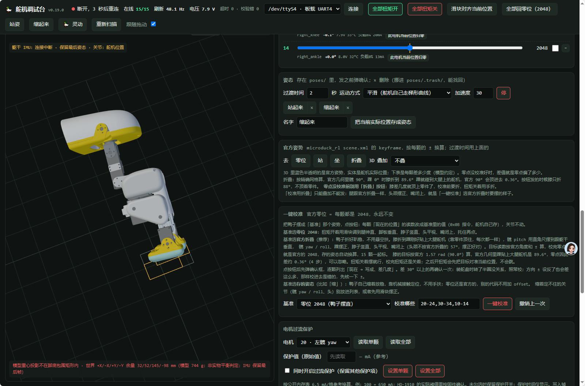

# MHDuck 舵机校准

更新：2026-10-24。适用于本仓库的飞特 HD-1910 调试台。重新安装软件或更换舵机、重装舵盘后，用本流程核对并校准零位。部署步骤见 [重新部署软件](重新部署软件.md)。

**操作顺序：启动校准网页 → 确认真机连接 → 摆好姿态 → 选择匹配基准 → 一键校准 → 核对结果。** 一键校准是把当前实物位置定义为基准读数，不会自动把摆歪的机器人摆正。

## 1. 在 RK3566 启动校准网页

先支撑好机器人，手指避开关节。通过 SSH 登录 **RK3566**，执行：

```bash
sudo systemctl restart servo-web
```

当前服务会停止 `robotd`、`padd`、`mediad`、`tofd`，独占调试所需硬件。保持供电充足，校准时不要启动键盘或手柄控制程序。

在 **PC 浏览器**打开 [http://192.168.2.90:8081/](http://192.168.2.90:8081/)，将 IP 替换为机器人实际地址。8081 是舵机调试台，8080 是另一套视频控制台。

## 2. 先确认连接与回读正常

- 页面显示已连接到实机，串口按当前板端配置为 `/dev/ttyS4`，不是模拟模式。
- 标准整机应有 **15/15** 颗舵机在线，位置、电压等数据持续刷新；不是保留的上一帧读数。
- 默认校准列表为 `20-24,30-34,10-14`。这些是总线 ID；其中嘴部 ID 是 `34`。
- 若有离线、反复超时或掉线，先解决供电和通信，不通过反复点击校准来试。

下图用于识别页面区域。**截图顶部实际显示“断开、3 秒后重连”，左侧也提示保留最后姿态；这是界面参考，不是可以开始校准的状态。** 必须等自己设备恢复连接并持续刷新后再操作。

<p></p>

## 3. 把真机摆成图 1 的零位姿态

图 1 是本教程使用的**摆直零位**，与网页中的 **“零位 2048（鸭子摆直）”** 对应。

<p></p>

逐项确认：

1. 左右腿伸直，髋和膝保持零位方向，不外撇、不扭转。
2. 脚底与小腿成直角，左右脚摆正；不要把“脚板垂直”理解成脚尖朝下。
3. 脖子竖直，头部平视朝正前方，不偏航、不歪头。
4. 嘴闭合，身体有稳定支撑，不依靠未校准的舵机目标勉强站住。

**手动摆姿态时，先托稳，再在网页关闭相应舵机扭矩；需要全身手摆时使用“全部扭矩关”。不要硬掰仍有力的舵机。** 也可在确认方向和范围后，用单颗小幅滑块调整到目标姿态。

关闭扭矩后关节会受重力下垂，必须用支撑或工装保持姿态直到校准完成。若需要重新上力，先把目标对齐当前位置，避免关节追向旧目标。

不要为了摆成图 1，先点击 **“全部回零位（2048）”**。零位尚未校好时，旧读数 2048 可能对应错误的实际姿态；该按钮会运动，不能替代校准。

<a id="fixture"></a>

## 4. 难以保持姿态时，使用校准工装

如果很难徒手把机器人摆正并保持不动，可以使用我们的校准工装。图 2 是维护者提供的工装与实物参考。

<p></p>

放入或取出工装前，先支撑机身并关闭相应舵机扭矩，按工装定位面放好。不能为了卡进槽内强压关节、夹住线束或让嘴部被工装顶开。工装用于重复定位与支撑，不会自动设置舵机零点。

**工装实际固定的姿态，必须和网页“基准”一致。不能仅凭“用了工装”就一律选择零位 2048。**

| 实际摆法 | 网页基准 |
| --- | --- |
| 图 1 的腿伸直、头颈摆正姿态 | `零位 2048（鸭子摆直）` |
| 按调试台说明固定为官方折叠，头颈摆正 | `官方折叠（腿折好趴稳、头颈摆正）` |
| 工装配套了其他专用姿态 | 使用与该工装确认匹配的基准，不用未校准时随手保存的姿态替代 |

图 2 的照片用于展示工装，不能仅凭照片确定每个关节的基准角度。如果工装固定的是折叠状态，就不按图 1 的摆直零位写入。需要使用“官方折叠”时，对照网页的“校准用折叠”叠加模型及文字逐关节核对：髋 pitch 与躯干垂直、膝折到踝刚贴大腿舵机、脚底与小腿成直角，髋 yaw / roll、头颈和嘴按提示摆正，不继续用力压机械限位。

## 5. 选择基准，点击“一键校准”

本节按**图 1 的摆直姿态**操作：

1. 在网页中找到“一键校准”区域。
2. “基准”选择 **“零位 2048（鸭子摆直）”**。
3. 核对“校准哪些”为 `20-24,30-34,10-14`，且这些舵机均在线。
4. 点击下图红框中的 **“一键校准”**。

<p></p>

5. 程序先读取并弹出逐颗 **“当前读数 → 目标读数、差几度”** 的预览。确认真机姿态、基准和 ID 都正确，再确认写入。位置读不到或预览缺少目标时，先处理错误。
6. 若差值超过 30°，页面还会要求再次确认。大偏差可能来自装配偏移，也可能是方向设置错误，不能不看原因就继续。先核对各关节方向；无法确定时取消本次写入。
7. 校准期间保持姿态、供电和网页连接稳定，不再拖滑块或点击其他动作按钮。

校准会写入舵机 EEPROM，并逐颗校验；当前程序先备份原偏移，按原有扭矩状态完成处理。**手动卸力后开始校准，不代表校准完成会自动恢复全身上力。** 不要在没有支撑的情况下撤掉工装或松手。

## 6. 检查结果，必要时撤销

完成后检查网页提示和日志：

- 标准整机应报告对应 15 颗完成；若有失败 ID，先看日志里的具体原因。已经成功的舵机可能已写入，不能把部分失败当作所有舵机都没改动。
- 对摆直基准，保持同一实物姿态时，位置应接近对应的 2048；如果校准过程中姿态改变或卸力下垂，应先恢复基准姿态再核对，不盲目反复校准。
- 保留每颗的前后读数和偏移记录。若实物仍明显不对，检查摆法、基准与方向，而不是通过修改行走模型的 HOME 掩盖校准问题。

需要撤销时先托稳机器人，核对本机对应备份后使用页面 **“撤销上一次”**。备份位置与迁移注意事项见下节；重新部署或清理目录前保留这些文件。

**软件重新上传不会自动代替零位校准。** 校准定义关节读数，模型负责动作推理；两者都正确后才能验证行走。

<a id="calibration-migration"></a>

### 校准文件与 RK3566 迁移

**实际生效的零点偏移保存在每颗舵机的 EEPROM 中，不依赖 RK3566 上的 JSON 文件加载。** `calib/` 中的 JSON 保存校准前的偏移、位置等备份，并记录本次校准的目标、差值与失败项；它用于“撤销上一次”，不是可直接导入另一只 duck 的校准结果。

标准部署目录为 `~/microduck/tools/servo-web/`，常用文件如下：

| 路径 | 内容 |
| --- | --- |
| `calib/eeprom-*.json` | 每次真实校准前的偏移备份及本次校准记录 |
| `logs/servo-web-YYYY-MM-DD.log` | 校准前后的位置读数、偏移及逐颗执行结果 |
| `directions.json` | 调试台各舵机的方向设置（±） |
| `poses/` | 保存的姿态；按零位或官方基准校准时会相应换算读数 |

例如，默认的备份和结果日志位置为：

```text
~/microduck/tools/servo-web/calib/eeprom-*.json
~/microduck/tools/servo-web/logs/servo-web-YYYY-MM-DD.log
```

旧版部署可能在 `~/servo-web/`。在原 RK3566 的 SSH 终端执行以下只读命令，查看 `WorkingDirectory` 和 `ExecStart`，确认服务实际使用的目录；上述文件位于运行中的 `server.py` 所在目录下：

```bash
systemctl cat servo-web
```

迁移时按实际硬件区分：

- **同一只 duck，只更换 RK3566：** 原舵机保留 EEPROM 中的校准，不需要靠复制文件恢复零点。需要保留调试台数据时，将 `directions.json`、`poses/`、`calib/`、`logs/` 一起备份，放到新板实际使用的调试台目录；恢复后核对舵机 ID、方向和基准读数。
- **另一只 duck，使用另一套舵机：** 应按那只 duck 的实际装配重新校准。复制旧文件不会使新舵机获得校准；**不要在新 duck 上使用旧 duck 的备份点击“撤销”**，否则会把旧舵机的偏移写入新舵机。旧备份仅作归档，不放进新 duck 正在使用的 `calib/`；方向和姿态也需按新机核对。

## 7. 结束校准，恢复日常控制

确认校准完成、没有失败关节，并在支撑条件下释放工装后，在 **RK3566 的 SSH 终端**运行：

```bash
sudo systemctl stop servo-web
sudo systemctl start robotd
sudo robotctl health
```

需要手柄控制时再执行 `sudo systemctl start padd`。使用键盘时保持 padd 停止，再运行交付的键盘控制脚本。先确认健康状态、姿态与关节方向，再按日常操作流程启用策略；校准后不要直接做大幅动作验证。

启动调试台时被停止的 `mediad`、`tofd` 按实际使用需求另行恢复。不能让调试台与日常控制端同时争用硬件。

## 8. 常见问题

| 现象 | 处理 |
| --- | --- |
| `Unit servo-web.service not found` | 先完成 [重新部署软件](重新部署软件.md)，或按 [调试台独立部署](tools/servo-web/DEPLOY.md) 补装服务 |
| 网页打不开 / 刚打开就断 | 检查 IP 和 8081 端口，查看 `systemctl status servo-web --no-pager -l` 及 `sudo journalctl -u servo-web -b -n 80 --no-pager` |
| 顶栏显示断开，但还显示 15/15 和 3D 模型 | 可能是保留数据，等连接恢复和读数持续更新，不立即校准 |
| 某颗舵机离线或预览读不到 | 先排查电池、连接线、ID 和串口占用，见 [故障排除](故障排除.md#servo) |
| 真机方向和 3D 相反 | 在支撑、卸力条件下逐关节小幅检查，核对对应方向设置；校准不能纠正错误的方向定义 |
| 点击“全部回零位”导致关节移动 | 这是动作按钮；校准使用“一键校准”区域内的同名按钮 |
| 一动就掉线、重启 | 先停止校准，按 [断开连接处理](断开连接处理.md) 检查供电和线束 |

图片由维护者提供，按钮与校准流程依据当前 [页面源码](tools/servo-web/index.html)、[服务端实现](tools/servo-web/server.py) 和 [部署说明](tools/servo-web/DEPLOY.md) 核对。本次仅整理教程，未执行实机校准。
